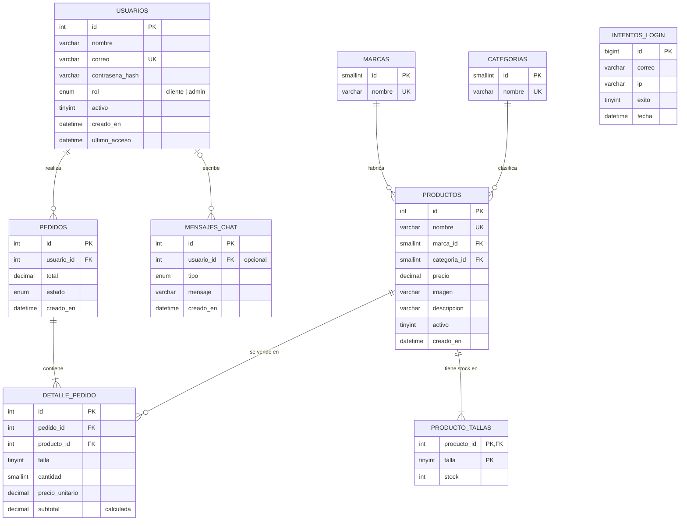

# Modelo Entidad–Relación — NexWeb

GitHub dibuja este diagrama automáticamente. Para exportarlo como imagen,
pega el bloque en https://mermaid.live y descarga el PNG/SVG.

## Relaciones (cardinalidad)

| Relación | Tipo | Explicación |
|---|---|---|
| usuarios → pedidos | 1 : N | Un cliente puede hacer muchos pedidos; cada pedido es de un solo cliente. |
| pedidos → detalle_pedido | 1 : N | Un pedido tiene uno o más renglones (producto + talla + cantidad). Si se borra el pedido se borran sus renglones (`ON DELETE CASCADE`). |
| productos → detalle_pedido | 1 : N | Un producto aparece en muchos pedidos. No se puede borrar un producto que ya se vendió (`ON DELETE RESTRICT`); para quitarlo del catálogo se pone `activo = 0`. |
| productos → producto_tallas | 1 : N | Cada tenis tiene un registro de stock por talla. Llave compuesta (producto_id, talla). |
| marcas → productos | 1 : N | Una marca tiene muchos productos. |
| categorias → productos | 1 : N | Una categoría agrupa muchos productos. |
| usuarios → mensajes_chat | 0..1 : N | Un mensaje puede ser de un usuario registrado o de un visitante (NULL). |
| intentos_login | — | Tabla de bitácora sin llaves foráneas a propósito: también registra correos que no existen. |

## Normalización

- **1FN:** todos los campos son atómicos (la talla y el stock no se guardan como lista dentro del producto, sino en `producto_tallas`).
- **2FN:** en `producto_tallas` (llave compuesta) el `stock` depende de la llave completa, no solo del producto.
- **3FN:** el nombre de la marca/categoría no se repite en `productos`; se guarda solo su `id`.
- **Excepción intencional:** `detalle_pedido.precio_unitario` copia el precio del producto. No es redundancia: es el precio *histórico* al momento de la compra.
